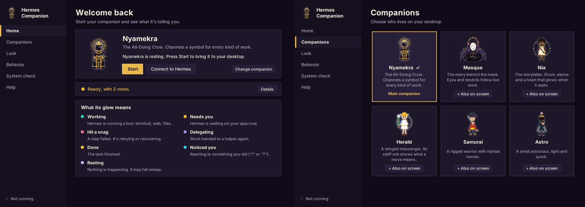
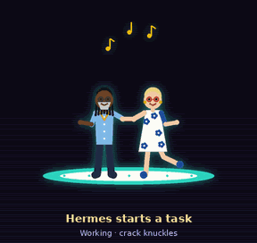
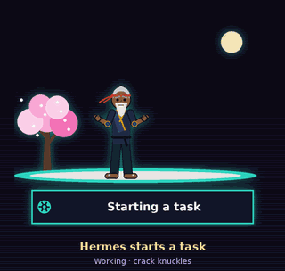
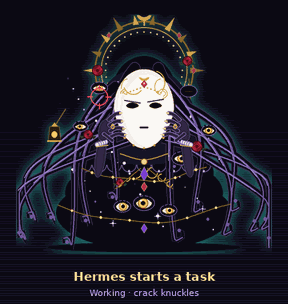
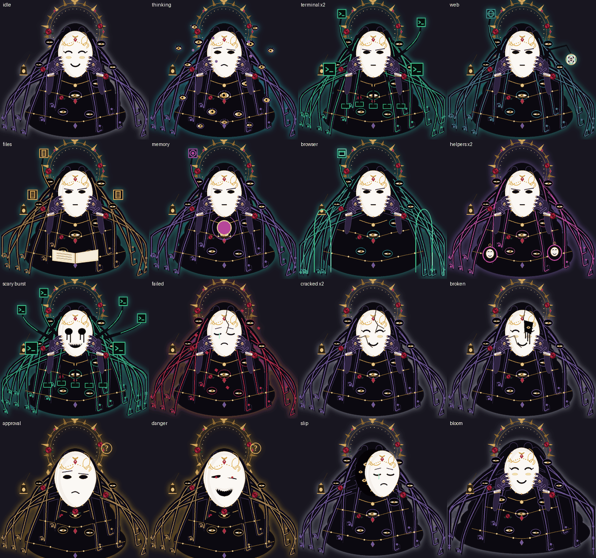
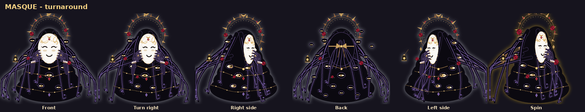
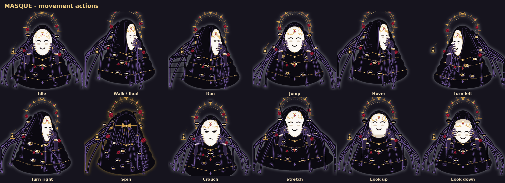
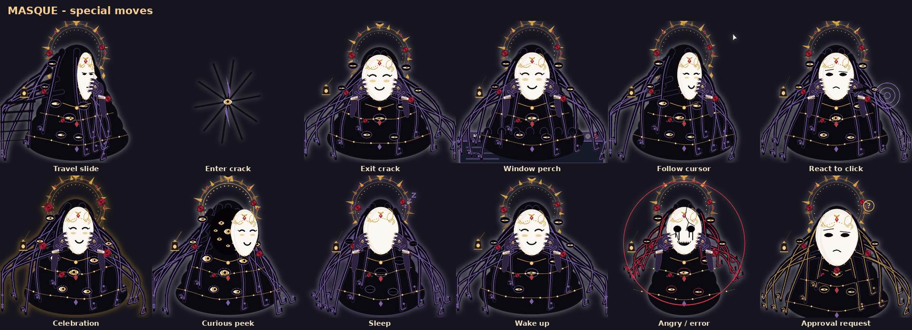
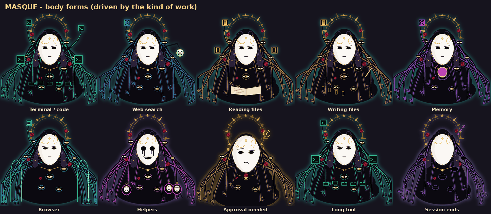

# Hermes Companion

**See what your AI agent is doing.** Hermes Companion is a desktop character
that reacts to the [Hermes](https://github.com/NousResearch/hermes-agent)
agent's real lifecycle events: it walks to a terminal when a tool runs, panics
and runs to you when approval is needed, celebrates when work finishes, and
falls asleep when the agent goes idle.


## Companion Home: one window for everything



Run `hermes-companion` with no arguments (or double-click the app the first
time, or left-click the tray icon) and **Companion Home** opens. It works like
a small OS for your companion:

| Page | What you do there |
|---|---|
| **Home** | Press **Start** (practice mode) or **Connect to Hermes** (live). **Hermes right now** shows what your agent is doing, in plain words, from signed events only. A key explains every glow colour. |
| **Companions** | Pick your main companion from picture cards. Invite up to three more onto the screen. |
| **Look** | Energy style and size, with a live preview. |
| **Behavior** | Talking, awareness and comfort settings, each explained in one line. |
| **System check** | The `doctor` checks as cards, each with its fix. |
| **Help** | How it works, the privacy promises, handy commands. |

Changes are staged in an "Unsaved" bar and applied together (Ctrl+S); a
running companion restarts with them. Ctrl+1 to Ctrl+6 switch pages.

One companion is on your desktop at a time. Starting another (from Home, the
tray, the app or a terminal) hands over smoothly: the old one closes itself.
Home sees and can stop a companion even if something else started it.

### A desktop icon

Double-click **`Add-Desktop-Icon.cmd`** once (or run `hermes-companion shortcut`,
or press **Put an icon on my desktop** on Home's Help page). A **Hermes Companion**
icon, Nyamekra's crowned head, appears on your desktop and opens Companion Home
with no terminal window. On Linux it adds a `.desktop` launcher instead.

## Easiest: download the app (Windows, no Python needed)

Grab **`HermesCompanion.exe`** from the
[latest release](https://github.com/hermz580/hermes-companion/releases/latest)
and double-click it. Nyamekra appears on your desktop and a tray icon gives
you every setting. From a terminal the same file takes any command:
`HermesCompanion.exe live`, `HermesCompanion.exe doctor`,
`HermesCompanion.exe play --palette fire --size large`.

## Try it in 30 seconds (Windows, no Hermes needed)

Download the repo ([Code → Download ZIP](https://github.com/hermz580/hermes-companion/archive/refs/heads/main.zip)),
unzip it and double-click **`Start-Companion.cmd`**. **Herald**, a winged
messenger, appears on your desktop. It reacts to what you do and acts out a
simulated Hermes session every 90 seconds. Or from a terminal:

```bash
pip install .
hermes-companion play                              # Herald
hermes-companion play --palette nebula             # olympus midnight ember verdant nebula
hermes-companion play --companion samurai          # or astro
```


### Nyamekra, the All-Doing Crow

```bash
hermes-companion play                       # Nyamekra is the default
Start-Companion.cmd                         # same, one click
```


One being, one form. Nyamekra is an Afrocentric anthropomorphic crow with
black feathers and a violet sheen. It has a gold crown with a sun-orb and a
celestial halo of orbital rings that is always present, plus galaxy eyes,
stacked gold neck rings, a golden ankh, and a feathered robe and mantle
woven with gold. It holds the world-orb.

From the turnaround sheet it also has a long feather cape, twin
gold-patterned stoles, hanging orb pendants and a second ankh, gold
gauntlets and greaves, and a taller jewelled crown. It turns to face the
way it travels.


**Every symbol means something.** Nyamekra channels the Symbol of Essence
that fits the work Hermes is really doing:

| Hermes is… | Symbols channelled |
|---|---|
| running terminal or dev work | pyramid (strength), sun (creation), spiral (evolution) |
| on the web | baobab (all knowledge), crow (the messenger), orbital rings (all realms) |
| working with files or plans | adinkra heart (wisdom), sun, moon (order) |
| using memory | baobab (roots), infinity (eternity), spiral (cycles) |
| delegating to helpers | pyramid on the way out, infinity on the return |
| waiting on you or approved | adinkra heart (patience) |
| quiet | moon (balance), with meditation, reading and preening |

When it notices you, it answers in its own body language: a head-cock,
glowing galaxy eyes, a caw. Its speech bubbles keep the same meanings in
its own voice ("I see the path. On it." / "Done. Every path leads here.").

Proof it works end to end:
`python -m hermes_companion.scripts.live_e2e nyamekra` drives the real Hermes
plugin hooks through a whole session (tools, a failure, an approval, a
helper) and checks that live Nyamekra acts out every event. CI runs it on
every change.

**Different tasks, different looks, same Nyamekra.** The body never changes.
Role gear appears only while Hermes is actually doing that kind of work, so
the look itself tells you what's happening, and a key-tool emblem glows on
the chest:

| Hermes is… | Look | Emblem |
|---|---|---|
| running terminal or dev work | Tech: headset and HUD | automation |
| on the web | Traveler: pack strap and satchel | travel |
| reading or organising files | Teacher: spectacles and scarf | knowledge |
| making media or design | Creative: beret and paint | creation |
| repairing or retrying | Healer: leaf sash and healing glow | healing |
| needing you | Tactical: gold pauldrons | protection |
| delegating to helpers | Celestial: spirit glow | omnipresence |
| using memory | Majestic | time |

**Nine expressions** follow what each move means: calm, focused, curious,
joyful, fierce, wise, playful, sad and protective. **Ten elemental energy
styles** (`--palette`): cosmic, earth, fire, water, air, shadow, light,
neon, natural and robotic. They change only the energy around Nyamekra,
never the being. **Sizes:** `--size tiny|standard|large`. **Dynamic poses:**
flight, landing, casting, perch, sprint, defense and interact.

```bash
hermes-companion play --palette fire --size large
```

Nyamekra never changes form. Its range comes from composition: 8 gestures
can each channel any of the 10 Symbols of Essence (ankh, adinkra heart,
crow, sun, moon, spiral, baobab, pyramid, orbital rings, infinity). On top
of that come 20 wing, crow-body and scene moves: wing spread, wing beat,
glide, caw, preen, halo spin, orb juggle and meditate, plus Commanding
Presence (scepter with armillary sphere), Cosmic Control (orbiting planets),
The Storyteller (seated, reading a glowing book among floating glyphs),
Glyph Weave and a back view. With every shared engine pose, the move grammar
turns that into millions of distinct performances of a single Hermes
action. The Hermes action itself never changes.

### Nia, the storyteller

```bash
hermes-companion play --companion nia                 # or: Start-Companion.cmd nia
hermes-companion play --companion nia --palette indigo   # kente indigo ochre emerald royal
```


Nia is a detailed Afrocentric companion: a textured afro, swinging locs
with gold cuffs and cowries, or a headwrap; a kente-inspired woven sash,
beaded collar, gold hoops and bangles; mudcloth-inspired wraps; and a
talking drum. An Akoma (heart) emblem glows while Nia waits on you.
Nia has more moves than the original companions: every shared engine pose,
plus 21 moves of its own (drum rolls, footwork, step-claps, spins,
storytelling and more). They're used only as decoration around Hermes's
signature moves, so they never change what an action means.

Herald's staff orb and aura show what a move *means*: teal = working,
violet = delegating, rose = failure, amber = needs you, gold = success,
cyan = curious, lavender = resting. "!" means it noticed something you did,
and "?" means it's wondering about it.

### Ade & Rae, the dancers

```bash
hermes-companion play --companion duet                     # classic (default)
hermes-companion play --companion duet --palette evening   # or carnival
```



Two partner dancers whose dance *is* the status. Ade leads: locs, a silver
beard, round glasses, a sky-blue shirt and a gold chain. Rae follows: short
golden hair, red round glasses, gold hoops and a white dress with blue flowers.
Every move the engine can emit has its own partner figure (94 in all), and
many of them are **real social and partner dances**: swing and Lindy hop,
salsa, ballroom, tango and street. The same Hermes action always gets the
same dance:

| Hermes is… | Ade & Rae dance… |
|---|---|
| starting a task | a bow, then a tango corte when it's on |
| launching a step | a Lindy **swingout** |
| working | a **sugar push**; still working: back to the **salsa basic** |
| running a terminal command | a **cha-cha** with Cuban hip motion |
| on the web | a travelling promenade |
| reading | a **promenade sway** |
| organising files / using memory | an **underarm turn** / an **inside turn** |
| working on code | switch sides: a **cross-body** crossover, trading places |
| making media / design | a double spin / a cross-body lead |
| a step finished | a **tuck turn**, then the **Charleston**, then a **moonwalk** home |
| sending out helpers | they separate; Ade does a **Shorty George**, Rae a **Suzie Q** |
| a helper is back | they come back together, a **copa**, a spin-out, a dip, then a **tandem Charleston** |
| needing your OK | they freeze and both reach toward you |
| you approved | a **kick-ball-change** and off they go |
| a step failed | a missed catch, then an **oversway** as she recovers in his arms |
| trying again | back to the **salsa basic** |
| finished the task | **the lift** (it means nothing else), then a Lindy **frog jump** |
| listening, glancing, wondering | lean in, glance back, tilt heads, think, peek |
| quiet or tired | a slow sway, head on a shoulder, a yawn, sitting it out |

**Jointed like dancers.** Each dancer has shoulders and elbows, hips and
knees, plus:

- a **spine** that bends the chest over the hips (sways, oversways, torso-led turns);
- a **hip shift** for Cuban motion and shimmies;
- a **neck** for promenade looks and the tango head snap;
- **wrists** for flicks and the robot;
- **ankles** that point or flex the foot (kicks, the moonwalk's heel lift);
- **foot swivel** for the Charleston twist, Suzie Q and Apple Jacks;
- **shoulders** that lift for shimmies.

The moves follow the real technique: the Charleston swivels the feet, a salsa
turn is led by the torso, an oversway softens the knee as she arches back.

The stage follows live work too, from signed events only:

- **Beat lights:** one per tool in flight. The floor takes that tool's colour, and more tools mean more bounce.
- **Backup dancers:** one per helper Hermes sends out.
- **Missteps:** each unrecovered failure adds falling petals and a sweat drop. Three clean steps heal one.
- **Danger:** a red floor when a dangerous command waits for your OK.
- **Thinking:** dots over their heads while Hermes thinks.
- **Confetti:** when the task is done.

**Easy to read at a glance.** Every part of both dancers has a clean dark
edge. Faces carry brows, glasses, a nose and a smile; Ade has a textured beard
and gold-cuffed locs, Rae has a fringe, lashes and gold hoops. Under the floor, a
**status plaque** says what Hermes is doing in plain words ("Running a command ·
terminal · 2 tools running", "Needs your OK · dangerous command", "Task
complete!"), with an icon for each meaning: gear, raised hand, cross, star,
helpers, moon, question mark. **Labelled badges** in the corner count tools,
helpers and missteps, and flag a dangerous command. The words come only from
the event kind, the tool category and counts, never from your prompts, files or
commands.

They also have 31 decorative moves of their own (jive kicks, shimmies, conga
hops, box steps, back-to-back, Apple Jacks, running man, cabbage patch, the
robot, Cuban motion, hip twists, ochos, ganchos, fallaways…). These play only around a signature move and
never replace one.

### Sensei, the master fighter

```bash
hermes-companion play --companion master                  # midnight (default)
hermes-companion play --companion master --palette jade   # or dawn
```



A master fighter whose fight *is* the status. **Every tool Hermes runs is a
ninja coming at him**, and its weapon names the kind of work:

| Tool category | Ninja |
|---|---|
| terminal | shuriken |
| web | kunai and rope |
| files | bo staff |
| code | twin blades |
| media | smoke bombs |
| memory | shadow ninja |

| Hermes is… | Sensei… |
|---|---|
| starting a task | bows, then drops into a horse stance |
| launching a step | **runs up the wall** and along its side |
| running a tool | **a real exchange** with that tool's ninja: he parries its jab (tan sau), it blocks his punch, he checks its kick with his shin, his roundhouse lands |
| running a command | a Muay Thai roundhouse, pivoting on the ball of the foot with the hip turned over |
| working on code / files | a sweep that takes two at once / disarms the bo staff |
| a long tool keeps going | **arrows fly in and he dodges every one** |
| reading, searching, memory | **sneaks up** on a ninja and takes it from behind |
| a step finished | a palm strike, then **throws the ninja far away** |
| a step failed | **the ninja's jab gets through**, he staggers, then shuts the next one down; a leg sweep takes him down; he kips back up; while fixing it he blocks an overhead weapon chop (age-uke) and **disarms** it |
| needs your OK | **catches an arrow** / **stops a thrown boulder** in a gold freeze ring, and waits |
| you approved / declined | flips up and goes / tosses it aside |
| sending out helpers | **shadow clones** step out and fight beside him |
| finished the task | a **long backflip**, then a **bicycle kick** |
| quiet / asleep | **rests under the blossom tree** while petals fall |

**It is a real fight, not a show.** The ninjas fight back: they jab, kick,
sweep low and swing their weapons, and they block or parry some of his
strikes (high block, low block, parry) while others land. A white spark marks
each point where a block meets a strike. When a tool fails, a hit really gets
through to him.

**Real stances, with their real weight.**

| Stance | Weight | Used for |
|---|---|---|
| Ma bu / kiba dachi (horse) | 50/50, deep knees | standing ready, rooting to stop a boulder |
| Gong bu / zenkutsu (bow, front) | ~70% front, back leg straight | reverse punch, tiger claw, leopard fist |
| Kokutsu dachi (back) | ~70% back | knife-hand block, arrow catch |
| Xu bu / neko ashi (empty, cat) | nearly all on the back leg, front toe touching | snake hand, cat-stance block |
| Pu bu (drop) | sits on one bent leg, the other straight out | the low sweep on code merges |
| Xie bu (cross) | legs crossed, sitting back | resting, dragon claw wind-up |
| Du li (crane) | one leg, raised thigh at least level | the crane |
| Yee jee kim yeung (Wing Chun) | toes turned in, knees in | chain punch, tan sau / bong sau |
| Muay Thai guard | upright, rear heel up | teep, elbow, knee, roundhouse |
| Ginga (Capoeira) | the swaying triangle step | walking in, dodging arrows |

**Real styles:** the Shaolin five animals (tiger claw, crane wings and beak,
leopard fist, snake spear-hand, dragon claw), Wing Chun, karate, Muay Thai
(teep, elbows, knee, roundhouse), Taekwondo (tornado kick, spinning hook),
Capoeira (ginga, aú, meia lua de compasso) and judo (the o-goshi hip throw
behind "throws the ninja far away"). A chip on the stage names the style or
technique being shown.

**Joints and detail.** He uses the same jointed rig as Ade & Rae. A new
**torso twist** joint turns the shoulders against the hips, so punches and
kicks drive from the hip. Each hand takes the shape its style uses: fist with
knuckles, open palm, knife-hand, tiger claw, crane beak, leopard fist,
snake spear-hand or dragon claw. Techniques are keyframed (chamber, strike,
follow-through, recover) with easing. The drawing adds gi shading that deepens
as he turns, cloth folds and creases, belt and headband tails that stream with
his speed, ground shadows that shrink when he jumps, afterimage trails on fast
strikes, and dust from the feet.

Badges count the ninjas in play, the clones, the hits taken and the ninjas
down. The plaque says what Hermes is doing in plain words ("Running a command
· 2 ninjas (kunai rope, shuriken)"). He also has 24 kata of his own. These
play only around a signature move and never replace one.

### Masque, the many behind the mask

```
hermes-companion play --companion masque                    # eerie (default)
hermes-companion play --companion masque --palette cute     # softer, fewer eyes
hermes-companion play --companion masque --palette monster  # every eye open, full grin
```





A vast, many-eyed form of hair-like tendrils under a thorn halo, holding a
porcelain mask in front of herself. The mask is what Hermes shows you; the
body is the work you don't see. Every part of her is driven by real Hermes
signals, not only her moves:

| Hermes signal | Masque shows |
|---|---|
| tools running at once | one tendril reaching up per tool, holding its glyph |
| kind of work | tendril sheen and aura: terminal green, web blue, files amber, memory violet, browser cyan, helpers magenta, approval gold, failure red |
| kind of work | her form: typist (floating keys), lantern (web), library (book), scribe (runes), vault (swallows an orb), cathedral crawler (browser) |
| thinking (`pre_llm_call`) | eyes open all over her body, sigils circle the mask |
| a tool failed | sad mask with a tear, red petals fall, and a crack - up to broken, with an eye showing through. Three successes in a row heal one crack |
| approval needed | a questioning mask and a gold "?" - an evil mask when Hermes flagged the command as dangerous |
| helpers started | small masked copies bud off, one per helper |
| a burst of parallel work | the scary mask |
| long tools (heartbeat) | her body pulses; it grows with the session's work |
| idle / asleep | cute mask / blank mask |

She travels by ink-slide, slips through a crack in the world to arrive
somewhere else, lunges toward you when Hermes needs you, and hovers onto
your windows. CI drives a real Hermes session through her too.

Every face carries its feeling around the mask: hearts (cute), tears (sad),
question marks (confused), a crosshair (focused), red sparks (scary), rising
smoke (evil) and slow dots (blank). The tool at work glows as a charm on her
chest and as a ring of light on the floor; helpers drift beside her as small
masked ghosts; her eyes blink on their own beats.

She turns: front, three-quarter, side profile and back (the mask's gold
ribbon tied over a crown of tendrils), and a full spin passes through all of
them. Travel and engine moves play side-on, facing the way she goes.






Regenerate these with `python -m hermes_companion.scripts.masque_sheets docs`.

## Quickstart

```bash
git clone https://github.com/hermz580/hermes-companion
cd hermes-companion
pip install .

hermes-companion --seed 42 demo        # headless demo, no Hermes needed
hermes-companion --seed 42 selfcheck   # determinism + safety self-check
hermes-companion live --demo           # on-screen overlay (Windows)
```

To drive it from a real Hermes session, install the observer plugin and run
`live`:

```bash
python hermes_companion/plugin/install.py
hermes plugins enable hermes-companion
hermes-companion live
```

## What it does

- **Shows Hermes's real work.** Every Hermes action has a fixed signature
  move (terminal work, approval wave, failure recoil) that is never altered.
- **Hundreds of thousands of variations.** Flourishes, gaits, tempos and
  entrances/exits are generated around each signature. Tests check 1,000 seeds
  per chain to prove that decoration never changes the meaning.
  Turn it off with `--no-variety`.
- **Curious about you.** The pet notices cursor dashes, hovering near it,
  focus switches, window moves/resizes/maximize/minimize, typing bursts and
  pauses, clicks, clipboard changes, displays plugged in, you stepping away
  and coming back, late nights and long sessions. It habituates to repeats
  and gets bored when nothing happens.
- **Lives on your windows.** It perches on the title bar of the window
  you're using, rides along when you drag it, hops over when you switch
  windows, and drops to the floor when you minimize or maximize. Whenever
  Hermes starts working, it jumps down so the real work plays on solid ground.
  Turn it off with `--no-perch`.
- **Smooth rendering.** Characters are drawn at 3x and anti-aliased, with a
  soft glow in their mood colour and squash-and-stretch. They're shown in a
  true per-pixel-alpha window, so there are no jagged edges or green fringes.
  `--render classic` switches back.
- **Hermes always wins.** While Hermes works, curiosity can only glance in
  place. While Hermes needs you or something failed, curiosity is silent.

### Privacy: what `--notice` reads

Sensors are content-free: positions, counters and on/off states only. They
never read key values, window titles, process names, clipboard contents or
screen pixels.

| `--notice` | Notices |
|---|---|
| `off` | nothing |
| `ambient` | cursor, windows, displays, away/back, time of day |
| `full` (default) | ambient + clicks, typing rhythm, clipboard *changed* |

## Requirements

| Feature | Needs |
|---|---|
| `demo`, `selfcheck`, `emit`, `scene` | Python 3.10+, Pillow |
| Transparent click-through overlay (`live`) | Windows 10/11 |
| Real event feed | Hermes agent with the bundled plugin |
| Your own pet | a Petdex/Codex spritesheet in `%LOCALAPPDATA%\hermes\pets` |

## How it works

Hermes hooks → content-free semantic events (HMAC-signed, allow-listed) →
deterministic behavior engine → movement planner → animation renderer.
Raw tool arguments and results never cross the plugin boundary.

Full architecture, multi-device relay and security notes:
[`hermes_companion/README.md`](hermes_companion/README.md) and
[`hermes_companion/docs/`](hermes_companion/docs/).

## Development

```bash
pip install -e ".[test]"
pytest
```

## Live with your real Hermes

```bat
Start-Companion.cmd live            :: Nyamekra follows your active Hermes session
Start-Companion.cmd live nia        :: any companion
```

The first `live` run installs and enables the Hermes observer plugin. Live
mode shows whichever Hermes session is active, because you asked for it
with `live`. Without Hermes it simply waits.

## Speech bubbles, sound and memory

- **Speech bubbles** (on by default) say what Hermes is doing in plain words:
  "On it!", "Working with terminal…", "I need your OK!", "All done!". The
  text comes only from Hermes's content-free status, never your prompts or
  files. Turn them off with `--no-bubbles`.
- **Sound** (`--sound`, off by default): soft synthesised chimes for start,
  done, needs-you and problems. There are no audio files, and it's rate-limited.
- **Memory** learns your rhythm: hours you're active, breaks and usual
  session length. It's stored as counts only in
  `%LOCALAPPDATA%\hermes-companion\personality.json`. That's how the
  companion knows to say "Good morning! Day 12 together", "Welcome back - nice
  break" or "Longer than usual today - time for a stretch?". Delete the file to
  make it forget, or use `--no-memory`.

## Tray, settings and friends on screen

- **Tray icon** (Windows): right-click the companion in the system tray to
  switch character, energy, size, curiosity, bubbles, sound, memory,
  perching and accessibility. Choices are saved, and the companion restarts
  with them.
- **Settings window:** pick "Settings…" from the tray, or run
  `hermes-companion settings`. Saved to
  `%LOCALAPPDATA%\hermes-companion\settings.json`. Command-line flags always
  win over saved settings.
- **Companions on screen together:** `hermes-companion play --with nia,herald`
  (up to three extra) puts them beside the main one, all acting out the
  same Hermes session.

## Accessibility and art

- `--reduced-motion`: minimal movement. No squash, no hops, fewer reactions.
- `--high-contrast`: a thick mood ring plus a plain-word label ("Working",
  "Needs you", "Problem", "Done").
- `--artpack FOLDER`: use your own painted frames. Put `<pose>.png` (or
  `<pose>_0.png`, `<pose>_1.png`… for animation) in a folder. Poses without
  art keep the built-in drawing, so a pack can start with a single image.
- macOS and Linux: the companion runs in a small normal window, since the
  transparent desktop overlay is Windows-only.

## Troubleshooting

Run `Start-Companion.cmd doctor`. It checks Python, Tk, Pillow, rendering,
the desktop window and the Hermes install, and says exactly what to fix.
Inside the folder you can type `hermes-companion ...` (for example
`hermes-companion play --palette fire --size large`) after the first
`Start-Companion.cmd` run. See [ROADMAP.md](ROADMAP.md) for what is next.

## License

See [LICENSE](LICENSE).


### Kia Kai, the skater

```bash
hermes-companion play --companion skater
hermes-companion play --companion skater --palette midnight
hermes-companion live --companion skater --follow
python -m pytest -q hermes_companion/tests/test_skater.py hermes_companion/tests/test_rig_pose_coverage.py
```

Kia Kai is an articulated street skater with a cap, gold-cuffed locs, vivid
hoodie, board and a small skatepark stage. He shares Sensei and Ade & Rae's
jointed renderer (shoulders and elbows, hips and knees, torso twist, neck,
wrists, ankles and foot swivels), not Sensei's fighter personality.
The stage is driven by the **same authenticated, content-free Hermes observer**:

| Verified Hermes event | Kia Kai's skate language |
|---|---|
| Task/step begins | Drops his board and pushes or rides a wall |
| Tools run or progress | Pushes, carves and holds a manual; a deck mark shows tool category |
| Code, files, media | Grinds the rail, balances, shuvits |
| Tool finished | Kickflip landing; landed count increases |
| Tool failed | Bails, board rolls away; recover and try again |
| Approval required | Stops the board in a glowing ring; red for dangerous actions |
| Helpers deployed or returned | Skate crew appears and comes back |
| Task complete | A big aerial board flip with confetti |
| Idle or sleep | Rests on the skatepark ledge |

The UI exposes Kia Kai alongside the existing companions in Home, the tray,
and `--companion skater`. Palettes: `street`, `midnight`, `sunrise`.
A subtle deterministic gesture distinguishes each engine pose; no prompt
text, command, file or result content is ever drawn. For visibility and
safety, the renderer trusts only the existing signed semantic event feed.
