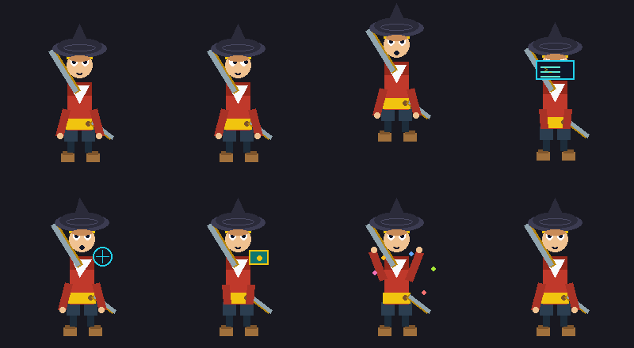

# Hermes Companion

**See what your AI agent is doing.** Hermes Companion is a desktop character
that reacts to the [Hermes](https://github.com/NousResearch/hermes-agent)
agent's real lifecycle events: it walks to a terminal when a tool runs, panics
and runs to you when approval is needed, celebrates when work finishes, and
falls asleep when the agent goes idle.



## Quickstart

```bash
git clone https://github.com/hermz580/hermes-companion
cd hermes-companion
pip install .

hermes-companion --seed 42 demo        # headless demo, no Hermes needed
hermes-companion --seed 42 selfcheck   # determinism + safety self-check
hermes-companion live --demo           # on-screen overlay (Windows)
```

To drive it from a real Hermes session, install the observer plugin and run
`live`:

```bash
python hermes_companion/plugin/install.py
hermes plugins enable hermes-companion
hermes-companion live
```

## What it does

- **Shows Hermes's real work.** Every Hermes action has a fixed signature
  move (terminal work, approval wave, failure recoil) that is never altered.
- **Hundreds of thousands of variations.** Flourishes, gaits, tempos and
  entrances/exits are generated around each signature. Tests check 1,000 seeds
  per chain to prove that decoration never changes the meaning.
  Turn it off with `--no-variety`.
- **Curious about you.** The pet notices cursor dashes, hovering near it,
  focus switches, window moves/resizes/maximize/minimize, typing bursts and
  pauses, clicks, clipboard changes, displays plugged in, you stepping away
  and coming back, late nights and long sessions. It habituates to repeats
  and gets bored when nothing happens.
- **Hermes always wins.** While Hermes works, curiosity can only glance in
  place. While Hermes needs you or something failed, curiosity is silent.

### Privacy: what `--notice` reads

Sensors are content-free: positions, counters and on/off states only. They
never read key values, window titles, process names, clipboard contents or
screen pixels.

| `--notice` | Notices |
|---|---|
| `off` | nothing |
| `ambient` | cursor, windows, displays, away/back, time of day |
| `full` (default) | ambient + clicks, typing rhythm, clipboard *changed* |

## Requirements

| Feature | Needs |
|---|---|
| `demo`, `selfcheck`, `emit`, `scene` | Python 3.10+, Pillow |
| Transparent click-through overlay (`live`) | Windows 10/11 |
| Real event feed | Hermes agent with the bundled plugin |
| Your own pet | a Petdex/Codex spritesheet in `%LOCALAPPDATA%\hermes\pets` |

## How it works

Hermes hooks → content-free semantic events (HMAC-signed, allow-listed) →
deterministic behavior engine → movement planner → animation renderer.
Raw tool arguments and results never cross the plugin boundary.

Full architecture, multi-device relay and security notes:
[`hermes_companion/README.md`](hermes_companion/README.md) and
[`hermes_companion/docs/`](hermes_companion/docs/).

## Development

```bash
pip install -e ".[test]"
pytest
```

## License

See [LICENSE](LICENSE).
