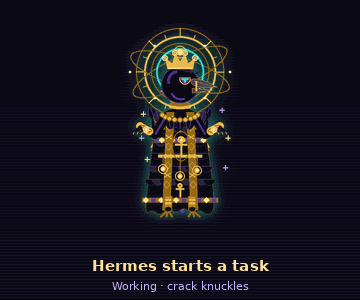
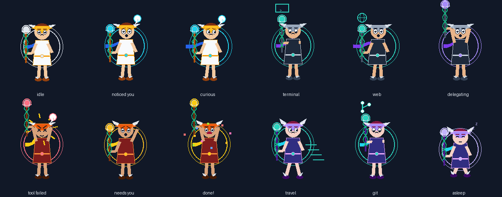
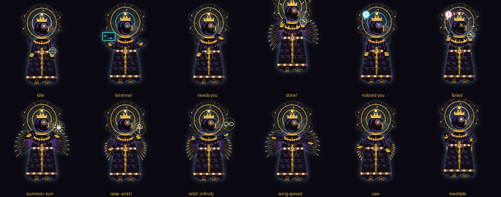
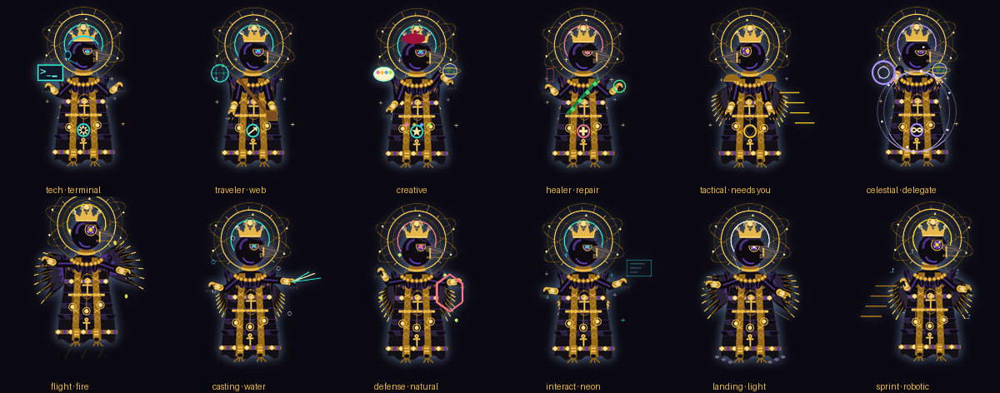
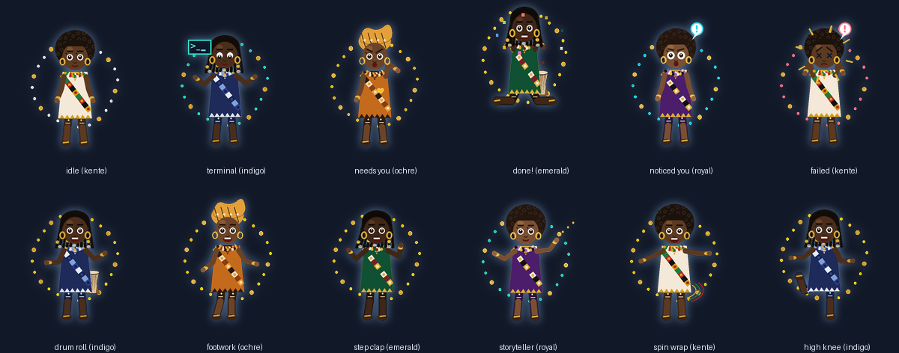

# Hermes Companion

**See what your AI agent is doing.** Hermes Companion is a desktop character
that reacts to the [Hermes](https://github.com/NousResearch/hermes-agent)
agent's real lifecycle events: it walks to a terminal when a tool runs, panics
and runs to you when approval is needed, celebrates when work finishes, and
falls asleep when the agent goes idle.



## Try it in 30 seconds (Windows, no Hermes needed)

Download the repo ([Code → Download ZIP](https://github.com/hermz580/hermes-companion/archive/refs/heads/main.zip)),
unzip it and double-click **`Start-Companion.cmd`**. **Herald**, a winged
messenger, appears on your desktop. It reacts to what you do and acts out a
simulated Hermes session every 90 seconds. Or from a terminal:

```bash
pip install .
hermes-companion play                              # Herald
hermes-companion play --palette nebula             # olympus midnight ember verdant nebula
hermes-companion play --companion samurai          # or astro
```



### Nyamekra, the All-Doing Crow

```bash
hermes-companion play                       # Nyamekra is the default
Start-Companion.cmd                         # same, one click
```



One being, one form. Nyamekra is an Afrocentric anthropomorphic crow with
black feathers and a violet sheen. It has a gold crown with a sun-orb and a
celestial halo of orbital rings that is always present, plus galaxy eyes,
stacked gold neck rings, a golden ankh, and a feathered robe and mantle
woven with gold. It holds the world-orb.

From the turnaround sheet it also has a long feather cape, twin
gold-patterned stoles, hanging orb pendants and a second ankh, gold
gauntlets and greaves, and a taller jewelled crown. It turns to face the
way it travels.



**Different tasks, different looks, same Nyamekra.** The body never changes.
Role gear appears only while Hermes is actually doing that kind of work, so
the look itself tells you what's happening, and a key-tool emblem glows on
the chest:

| Hermes is… | Look | Emblem |
|---|---|---|
| running terminal or dev work | Tech: headset and HUD | automation |
| on the web | Traveler: pack strap and satchel | travel |
| reading or organising files | Teacher: spectacles and scarf | knowledge |
| making media or design | Creative: beret and paint | creation |
| repairing or retrying | Healer: leaf sash and healing glow | healing |
| needing you | Tactical: gold pauldrons | protection |
| delegating to helpers | Celestial: spirit glow | omnipresence |
| using memory | Majestic | time |

**Nine expressions** follow what each move means: calm, focused, curious,
joyful, fierce, wise, playful, sad and protective. **Ten elemental energy
styles** (`--palette`): cosmic, earth, fire, water, air, shadow, light,
neon, natural and robotic. They change only the energy around Nyamekra,
never the being. **Sizes:** `--size tiny|standard|large`. **Dynamic poses:**
flight, landing, casting, perch, sprint, defense and interact.

```bash
hermes-companion play --palette fire --size large
```

Nyamekra never changes form. Its range comes from composition: 8 gestures
can each channel any of the 10 Symbols of Essence (ankh, adinkra heart,
crow, sun, moon, spiral, baobab, pyramid, orbital rings, infinity). On top
of that come 20 wing, crow-body and scene moves: wing spread, wing beat,
glide, caw, preen, halo spin, orb juggle and meditate, plus Commanding
Presence (scepter with armillary sphere), Cosmic Control (orbiting planets),
The Storyteller (seated, reading a glowing book among floating glyphs),
Glyph Weave and a back view. With every shared engine pose, the move grammar
turns that into millions of distinct performances of a single Hermes
action. The Hermes action itself never changes.

### Nia, the storyteller

```bash
hermes-companion play --companion nia                 # or: Start-Companion.cmd nia
hermes-companion play --companion nia --palette indigo   # kente indigo ochre emerald royal
```



Nia is a detailed Afrocentric companion: a textured afro, swinging locs
with gold cuffs and cowries, or a headwrap; a kente-inspired woven sash,
beaded collar, gold hoops and bangles; mudcloth-inspired wraps; and a
talking drum. An Akoma (heart) emblem glows while Nia waits on you.
Nia has more moves than the original companions: every shared engine pose,
plus 21 moves of its own (drum rolls, footwork, step-claps, spins,
storytelling and more). They're used only as decoration around Hermes's
signature moves, so they never change what an action means.

Herald's staff orb and aura show what a move *means*: teal = working,
violet = delegating, rose = failure, amber = needs you, gold = success,
cyan = curious, lavender = resting. "!" means it noticed something you did,
and "?" means it's wondering about it.

## Quickstart

```bash
git clone https://github.com/hermz580/hermes-companion
cd hermes-companion
pip install .

hermes-companion --seed 42 demo        # headless demo, no Hermes needed
hermes-companion --seed 42 selfcheck   # determinism + safety self-check
hermes-companion live --demo           # on-screen overlay (Windows)
```

To drive it from a real Hermes session, install the observer plugin and run
`live`:

```bash
python hermes_companion/plugin/install.py
hermes plugins enable hermes-companion
hermes-companion live
```

## What it does

- **Shows Hermes's real work.** Every Hermes action has a fixed signature
  move (terminal work, approval wave, failure recoil) that is never altered.
- **Hundreds of thousands of variations.** Flourishes, gaits, tempos and
  entrances/exits are generated around each signature. Tests check 1,000 seeds
  per chain to prove that decoration never changes the meaning.
  Turn it off with `--no-variety`.
- **Curious about you.** The pet notices cursor dashes, hovering near it,
  focus switches, window moves/resizes/maximize/minimize, typing bursts and
  pauses, clicks, clipboard changes, displays plugged in, you stepping away
  and coming back, late nights and long sessions. It habituates to repeats
  and gets bored when nothing happens.
- **Lives on your windows.** It perches on the title bar of the window
  you're using, rides along when you drag it, hops over when you switch
  windows, and drops to the floor when you minimize or maximize. Whenever
  Hermes starts working, it jumps down so the real work plays on solid ground.
  Turn it off with `--no-perch`.
- **Smooth rendering.** Characters are drawn at 3x and anti-aliased, with a
  soft glow in their mood colour and squash-and-stretch. They're shown in a
  true per-pixel-alpha window, so there are no jagged edges or green fringes.
  `--render classic` switches back.
- **Hermes always wins.** While Hermes works, curiosity can only glance in
  place. While Hermes needs you or something failed, curiosity is silent.

### Privacy: what `--notice` reads

Sensors are content-free: positions, counters and on/off states only. They
never read key values, window titles, process names, clipboard contents or
screen pixels.

| `--notice` | Notices |
|---|---|
| `off` | nothing |
| `ambient` | cursor, windows, displays, away/back, time of day |
| `full` (default) | ambient + clicks, typing rhythm, clipboard *changed* |

## Requirements

| Feature | Needs |
|---|---|
| `demo`, `selfcheck`, `emit`, `scene` | Python 3.10+, Pillow |
| Transparent click-through overlay (`live`) | Windows 10/11 |
| Real event feed | Hermes agent with the bundled plugin |
| Your own pet | a Petdex/Codex spritesheet in `%LOCALAPPDATA%\hermes\pets` |

## How it works

Hermes hooks → content-free semantic events (HMAC-signed, allow-listed) →
deterministic behavior engine → movement planner → animation renderer.
Raw tool arguments and results never cross the plugin boundary.

Full architecture, multi-device relay and security notes:
[`hermes_companion/README.md`](hermes_companion/README.md) and
[`hermes_companion/docs/`](hermes_companion/docs/).

## Development

```bash
pip install -e ".[test]"
pytest
```

## Live with your real Hermes

```bat
Start-Companion.cmd live            :: Nyamekra follows your active Hermes session
Start-Companion.cmd live nia        :: any companion
```

The first `live` run installs and enables the Hermes observer plugin. Live
mode shows whichever Hermes session is active, because you asked for it
with `live`. Without Hermes it simply waits.

## Speech bubbles, sound and memory

- **Speech bubbles** (on by default) say what Hermes is doing in plain words:
  "On it!", "Working with terminal…", "I need your OK!", "All done!". The
  text comes only from Hermes's content-free status, never your prompts or
  files. Turn them off with `--no-bubbles`.
- **Sound** (`--sound`, off by default): soft synthesised chimes for start,
  done, needs-you and problems. There are no audio files, and it's rate-limited.
- **Memory** learns your rhythm: hours you're active, breaks and usual
  session length. It's stored as counts only in
  `%LOCALAPPDATA%\hermes-companion\personality.json`. That's how the
  companion knows to say "Good morning! Day 12 together", "Welcome back - nice
  break" or "Longer than usual today - time for a stretch?". Delete the file to
  make it forget, or use `--no-memory`.

## Accessibility and art

- `--reduced-motion`: minimal movement. No squash, no hops, fewer reactions.
- `--high-contrast`: a thick mood ring plus a plain-word label ("Working",
  "Needs you", "Problem", "Done").
- `--artpack FOLDER`: use your own painted frames. Put `<pose>.png` (or
  `<pose>_0.png`, `<pose>_1.png`… for animation) in a folder. Poses without
  art keep the built-in drawing, so a pack can start with a single image.
- macOS and Linux: the companion runs in a small normal window, since the
  transparent desktop overlay is Windows-only.

## Troubleshooting

Run `Start-Companion.cmd doctor`. It checks Python, Tk, Pillow, rendering,
the desktop window and the Hermes install, and says exactly what to fix.
Inside the folder you can type `hermes-companion ...` (for example
`hermes-companion play --palette fire --size large`) after the first
`Start-Companion.cmd` run. See [ROADMAP.md](ROADMAP.md) for what is next.

## License

See [LICENSE](LICENSE).
